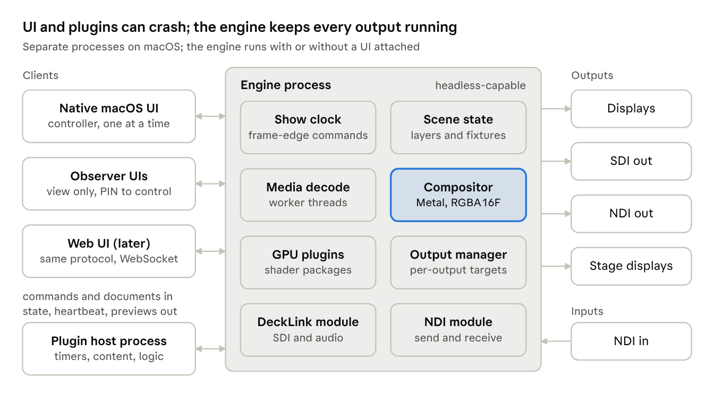
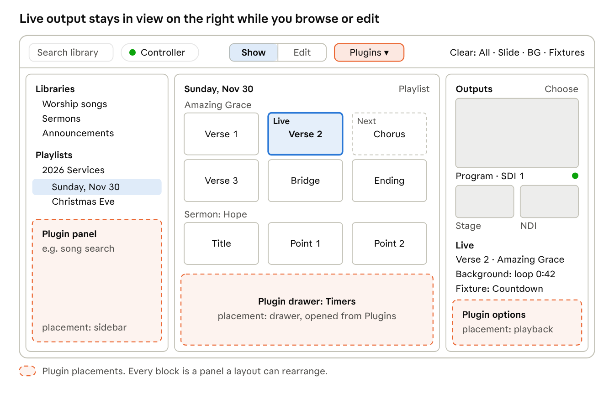
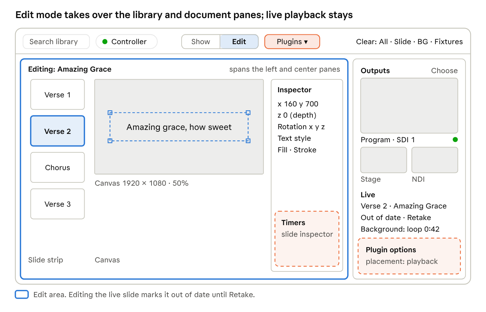
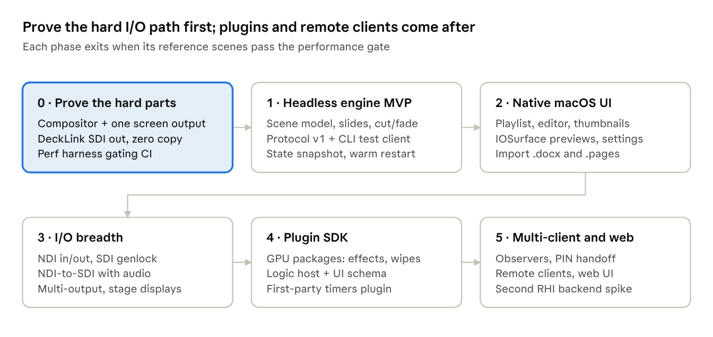

# Presentation Engine — Architecture Plan

> Exported from the living plan doc. The contracts it references are in this repository; see [CONTRACTS.md](../CONTRACTS.md).

Nov 26, 2026 · @Jason Terhorst

## Summary and principles

Build a small, headless-capable render engine as its own process. It does three things: keeps time, composites layers in Metal, and moves frames to and from outputs. Everything else is a client, a plugin, or a module that talks to it over one versioned protocol.

The principles below are the tie-breakers for every later decision.

1. **The frame is sacred.** The render thread never waits on disk, network, IPC, plugins or the UI. If data isn't ready, it renders the last good frame and records the miss.
2. **The core stays small.** A feature belongs in core only if it can't be built on the public plugin or module API. If the API can't express it, extend the API, not the core.
3. **Pay only for what you use.** A disabled feature costs zero GPU time and zero allocations per frame. That's how new features avoid slowing down rendering.
4. **Proven game-engine patterns.** Fixed-step command application, double/triple-buffered frames in flight, flat render lists rebuilt per frame, a job system for decode, offline shader compilation, hot reload in development.
5. **Platform seams, not platform abstractions everywhere.** Only four things sit behind interfaces: GPU (RHI), media decode, video I/O, and IPC transport. macOS implementations come first; everything else is plain portable code.
6. **The engine owns live state; the UI owns documents.** The controller pushes documents in. The engine never edits a document. It only reports state.

## Process architecture

There are three kinds of process: one engine, any number of UI clients, and zero or more plugin hosts. Only the engine touches GPU outputs and video hardware.



Everything left of the engine talks one protocol; everything right of it is a module the engine loads.

- **Engine.** A standalone executable, launched by the UI or by launchd as a LaunchAgent with KeepAlive. It owns the show clock, scene state, GPU, decode and outputs. It writes a small state snapshot (background, live slide, fixtures, output config) on every change, so a restart comes back showing what was live.
- **UI clients.** The native macOS app comes first. A client never draws to an output. A relaunched UI reattaches with its session token and gets its role back.
- **Plugin hosts.** Plugin logic (timers, content providers, integrations) runs out of process. A crashing plugin is restarted; its fixtures hold their last state in the meantime.
- **Modules.** Trusted native code loaded into the engine as dylibs at runtime, for I/O: DeckLink, NDI, later platform outputs. Loading at runtime keeps proprietary SDKs out of the core binary (the core is MPL-2.0; see Decisions).
- **Headless.** `--headless` starts the engine with no UI. It listens on localhost only by default; LAN listening is an explicit setting with pairing.
- **Watchdogs.** Each output has a deadline per frame. If a module or plugin stalls, that output repeats its last frame (or cuts to black, per output setting) and the miss is reported in the heartbeat.

## Tech stack

Write the engine in C++20 behind a thin in-house RHI, with Metal as the first backend. Write the macOS UI in Swift. Both choices follow what shipping game engines and broadcast tools do, and both fit the vendor SDKs (DeckLink, NDI) that ship C/C++ headers.

| Decision | Recommendation | Why | Main alternative |
| --- | --- | --- | --- |
| Engine language | Decided: C++20, small subset (no exceptions across module boundaries, RAII, no RTTI in hot paths) | Industry standard for engines; DeckLink and NDI SDKs are C++; ports cleanly to Windows and Linux | Rust, rejected: same native libraries, but we would own the DeckLink and Metal bindings (see Library support) |
| Metal access | metal-cpp (Apple's C++ wrapper) | Same API surface as Objective-C Metal with no bridging layer in the render loop | Objective-C++ files at the platform seam |
| GPU abstraction | Thin in-house RHI: buffers, textures, pipelines, compute, command lists, fences, shared-texture import | 2D compositing needs a small API; owning it keeps zero-copy video paths (IOSurface, CVPixelBuffer) first-class | SDL3 GPU API if you'd rather not own a backend layer |
| Shader language | Slang, compiled offline to MSL now and SPIR-V or DXIL later | One source per effect, all backends; plugin authors write once | HLSL with DXC + SPIRV-Cross |
| Video decode (macOS) | AVFoundation + VideoToolbox into CVPixelBuffer, mapped to Metal via CVMetalTextureCache | Hardware ProRes and HEVC (with alpha), zero-copy to GPU | FFmpeg behind the same decoder seam for other platforms |
| Text | Core Text for shaping and layout behind a text seam; rasterize to a cached texture when content changes; the UI links the same layout library | Correct typography now; text changes rarely, so caching is cheap | HarfBuzz + FreeType for portability later |
| Protocol schema | Protocol Buffers | Codegen for C++, Swift and TypeScript; safe schema evolution; frames never ride it, so speed isn't a concern | FlatBuffers if documents get very large |
| UI (macOS) | SwiftUI with AppKit where needed | Native feel and fast to build for an iOS developer | Electron, only if the web UI must ship first |
| Build | CMake for the engine, Xcode project for the UI, both in one repo | CMake is what ports need; Xcode is what a Mac app needs | Bazel |

**Minimum OS.** macOS 27 Golden Gate runs only on Apple silicon, so the engine can assume unified memory. That matters: the GPU can write an SDI frame into a buffer DeckLink reads directly, with no copy.

### Library support

Every I/O and media library the engine needs is native C or C++, so the engine calls them directly with no binding layer to maintain. Formats and latency come from these libraries and the zero-copy paths between them, not from the language.

| Library | Used for | How the engine uses it |
| --- | --- | --- |
| DeckLink SDK | SDI out, embedded audio, fill+key | Blackmagic's C++ SDK, called directly in the DeckLink module |
| NDI SDK 6 | NDI send and receive, including audio | C API, loaded at runtime in the NDI module |
| AVFoundation + VideoToolbox | Hardware ProRes, HEVC (with alpha) and H.264 decode; H.264 preview encode | Objective-C++ at the decode seam; frames reach Metal through CVMetalTextureCache with no copy |
| FFmpeg (libavformat, libavcodec) | Every other container and codec | C API behind the same decoder seam, using VideoToolbox hardware decoding where the codec allows; LGPL build, linked dynamically |
| Metal | Rendering and compute | metal-cpp |

Why not Rust: the same libraries are reachable, but through bindings of uneven maturity. The [decklink crate](https://lib.rs/crates/decklink) has one unstable release from March 2023 and depends on a C shim. An early [ndi-sdk-sys](https://docs.rs/crate/ndi-sdk-sys/0.1.0/source/README.md) release listed audio frame access as unsupported. The [metal crate](https://docs.rs/crate/metal/latest) is deprecated in favor of objc2-metal. We would end up maintaining those layers ourselves.

## Scene model

Each output shows one ordered stack of layers. The background, the live slide and every fixture are layers that differ only in lifetime and default z-order. One compositor handles them all.

| Layer | Lives until | Set by | Default z |
| --- | --- | --- | --- |
| Background | Replaced by a slide or plugin, or cleared | Slide, plugin, operator | 0 |
| Slide | The next slide (with a transition) or clear | Operator via controller | 100 |
| Fixture | Dismissed by operator, plugin or clear | Slide action, plugin, operator | Configurable: any integer, above or below the slide |
| Plugin layer | Its owner removes it | Effect or content plugin | Declared by the plugin |

**Elements** are what's inside a slide or fixture: text, shape, image, video, live input (NDI) or a plugin-provided source. Each element has:

- A 3D position (z = 0 is the base plane; positive z comes toward the viewer, with perspective from the slide's camera), size, rotation on all three axes, opacity, crop, and a **blend mode**: normal, add, multiply, screen, overlay, darken, lighten, soft light, difference.
- An optional **mask**: any media or shader output, used as alpha or luma, with invert. A mask shorter than its content loops.
- An optional **effect stack**: ordered shader effects or effect media, each with its own blend mode and opacity.

**IDs everywhere.** Every document, slide, element, fixture and media item has a stable ID. That makes document diffs, plugin targeting ("inject into element X") and state reporting cheap.

**Text.** RTF is the source of truth for styled text. Text flows inside an optional container path (any shape) minus exclusion paths it wraps around. The shared C++ text library handles a defined RTF subset for the engine and the native editor, and compiles to WebAssembly for the web UI.

**Extensions.** Every entity carries operator-visible `metadata` and plugin-owned `extensions`, keyed by plugin id, holding structured data. Plugins can also define their own element types, which they resolve ahead of time into core elements; the document keeps a fallback so it still renders without the plugin. The engine and every client round-trip data they don't understand. The full rules are in the contracts (CONTRACTS.md, section 2).

**Media by reference.** Documents point to media by content hash plus a hint path. The engine resolves hashes from its media store. A remote or web UI uploads media to the engine before sending a document that uses it, so headless machines work the same as local ones.

**Blend space.** Composite in linear light for correct crossfades and alpha. Offer a per-blend-mode flag to blend in gamma space, because designers expect overlay and soft light to match Photoshop.

## Render pipeline and frame pacing

Each output renders at its own native resolution and rate, driven by its own clock. All outputs sample one shared scene at a timestamp, so they agree on what is live. That's the standard game-engine split: simulate once, render per view.

One frame for one output:

1. **Tick.** The output's clock fires (CAMetalDisplayLink for screens, DeckLink's scheduled-frame callback for SDI, a timer for NDI). Queued commands apply atomically at this edge. Commands never mutate state mid-frame.
2. **Resolve.** Walk the layer stack into a flat render list for this output: what to draw, with which inputs, masks and effects. No allocation; reuse last frame's arrays.
3. **Acquire media.** Take the newest decoded frame at or before the frame's timestamp from each source's ring buffer. Never wait. Decode runs ahead on worker threads.
4. **Build the render graph.** A layer with no effects or mask draws straight into the output target. A layer with effects, a mask or a transition gets a pooled offscreen texture first.
5. **Composite** into an RGBA16F target in linear light.
6. **Convert** in one compute pass to the output's format: BGRA for screens, UYVY or v210 (10-bit) for SDI, UYVY or BGRA for NDI. Fill+key outputs write two buffers.
7. **Hand off.** Present to the display, schedule the shared buffer with DeckLink, or queue to the NDI sender's async thread.
8. **Preview.** If a client subscribed, downscale to the requested size and publish (see Video I/O).

**Frames in flight.** Two or three per output, with fences, so CPU work on frame N+1 overlaps GPU work on frame N. Deeper queues add latency; make depth a per-output setting with a sensible default.

**Mismatched rates.** An NDI input at 29.97 feeding a 59.94 output repeats frames; a 60 input on a 50 output drops them. Nearest-frame is the default. Blended conversion can be a later plugin.

**Genlock (v1).** When an SDI output has a reference signal, the DeckLink card times scheduled frames to it, so that output's tick follows house sync. Screens and NDI can't lock to reference and keep their own clocks. In a genlocked show, the SDI output is the master clock for media playback and audio; other outputs repeat or drop frames against it.

**Thumbnails.** The engine renders slide thumbnails on request on a low-priority command queue. Thumbnails then match output exactly, and they never compete with live frames.

## Video I/O, stage displays and previews

Every destination is an output with a target size, rate, pixel format and a layer stack. SDI, NDI and screens differ only in their hand-off module, so a stage display can go out any of them.

| Output | macOS path | Notes |
| --- | --- | --- |
| Screen | Borderless fullscreen window per display, CAMetalLayer, CAMetalDisplayLink | One output per physical display; survives display reconnects |
| SDI | DeckLink SDK scheduled playback from a custom video buffer backed by a shared-storage Metal buffer | Zero copy on Apple silicon; embedded audio at 48 kHz; genlock to black burst or tri-level reference; fill+key where the card supports keying |
| NDI out | NDI SDK async send | Video plus the engine's audio mix; alpha supported |
| NDI in | NDI SDK receive on its own thread into a ring buffer | Usable as a background, element or passthrough source |
| Preview (local) | IOSurface passed to the UI over XPC | Zero copy; the UI sets it as a CALayer's contents |
| Preview (remote) | VideoToolbox low-latency H.264, sent over WebSocket | Browser decodes with WebCodecs; encode runs only while someone subscribes |

**NDI-to-SDI passthrough.** Treat it as a routing preset, not a special mode: an NDI source as a full-frame layer on an SDI output. You get overlays on top for free. The hard part is clocks. The NDI sender's clock and the DeckLink clock drift apart, so:

- Video repeats or drops a frame when the buffer drifts past a threshold.
- Audio goes through a small adaptive resampler that holds the buffer depth steady. Convert NDI's float audio to 48 kHz integer PCM and schedule it aligned to the video frame it belongs to.
- Report buffer depth and drift corrections in the heartbeat so operators can see a bad source.

**Audio overall.** Keep a minimal audio graph in core: sources (media, NDI input) into a mix bus, then out to a Core Audio device, DeckLink embedded audio and NDI. Anything fancier (ducking, routing matrices) is a module.

**Stage displays.** The UI owns each stage layout, as specced. Decided change from the spec: layouts contain bindings (current slide text, next slide, notes, clock, timer values) that the engine resolves every frame. The UI still pushes layout and content on each event, but stage displays stay correct if the UI crashes mid-service.

**Preview sizing.** Each client subscribes per output with a size and max rate. The engine downsamples in one compute pass and shares one preview per output and size bucket across all clients asking for it.

## Control protocol

One Protobuf protocol runs over two transports: XPC for local clients on macOS, and WebSocket for headless, remote and browser clients. Every message shares one envelope: sequence number, session ID, message type and payload. The handshake negotiates protocol version and capabilities, so old UIs fail clearly instead of strangely.

**Message families**

- **Session:** hello, role assignment, heartbeat, control request and handoff.
- **Document:** load playlist, replace document, later per-entity patches.
- **Commands:** take slide, clear layer, set background, show or dismiss fixture, retake, media transport (play, pause, seek).
- **State:** event deltas pushed immediately, plus full snapshots on connect and on request.
- **Preview:** subscribe and unsubscribe per output, with size and max rate.
- **Plugin:** UI schema, plugin state, actions back from the UI.
- **Settings:** engine settings, described by the same schema as plugin UIs (see Plugin system).

**Roles.** The first client to connect becomes the controller and sends the playlist. Every later client is an observer and receives the document plus live state. Only the controller's commands are accepted; others get a clear "not controller" error.

**Handing off control**

1. An observer sends a control request with a display name.
2. The engine generates a one-time 6-digit PIN and sends it only to the controller, which shows it with the requester's name.
3. The controller's operator tells the requester the PIN.
4. The requester submits it. The engine checks it with a short expiry and an attempt limit.
5. On a match, roles swap atomically. The old controller becomes an observer, and everyone gets a role-change event.

**When the controller disappears.** Hold control for its session token for a configurable grace period, so a crashed UI that relaunches gets control back. After that, control is vacant, and the first observer to request it gets it without a PIN. Remote clients can only connect if LAN access is enabled with pairing. A local admin command on the engine machine can always reclaim control.

**Heartbeat.** The engine sends it to every client at a fixed rate. It carries engine time, per-output health (frame rate, drops, buffer depth) and each playing media item's playhead as position, timestamp and rate. UIs interpolate playheads locally for smooth scrubbers, with no 60 Hz traffic. A client that misses several heartbeats shows "engine disconnected".

**Edits while live.** As specced, the controller re-sends the document after an edit and gets a new revision. The live slide keeps rendering the version it was taken with. The engine flags "live content is out of date" in state, so the UI can show a badge and offer Retake. Nothing re-displays automatically.

## Plugin system

Split extensions into three tiers by trust and by where they run. GPU work is data the engine loads; logic runs out of process; only trusted I/O code runs natively inside the engine.

| Tier | Runs in | Can do | Examples |
| --- | --- | --- | --- |
| GPU package | Engine, as shaders and media only, no native code | Effects, transitions, masks, procedural layers | Blur, glow, luma wipe, film grain, looping light leaks |
| Logic plugin | Plugin host process, any language | Hold state, react to events, inject elements and fixtures, set backgrounds, offer a UI | Timers, scripture lookup, lower-thirds from a spreadsheet, MIDI triggers |
| Module | Engine, native dylib, trusted | New outputs, inputs, decoders, platform services | DeckLink, NDI, future Windows output |

**Effect contract.** Inputs: the layer's texture, time, parameters, and optional media or mask textures. Output: a texture of the same size. Multi-pass and compute are allowed. Effect media can be pre-rendered loops with alpha, applied with any blend mode, or used as a looping mask.

**Transition contract.** Inputs: the outgoing and incoming textures, progress from 0 to 1, duration, easing and parameters. A transition may apply effects to either side, use a shader or media matte, and insert its own layers for its duration.

**Content plugins push scenes, not frames.** A plugin answers events (slide taken, element shown, timer fired) with declarative edits: inject element E into slide S, show fixture F at z 150, set background B. For anything that changes every frame, it sends **bindings** the engine evaluates itself. A countdown is a text element bound to a deadline timestamp, so the engine updates the digits every frame with zero IPC.

**Stateful plugins.** A timers plugin keeps its list of timers as plugin state, publishes fixtures with deadline bindings, and exposes start, stop and reset as UI actions. Plugin state is published as a snapshot plus patches, so observers stay in sync.

**Safety.** Shaders compile at install time and are cached. The engine measures GPU time per effect instance and reports it. Over budget, it can bypass the effect rather than drop frames. Logic plugins declare capabilities (network, which layers they may touch) in a manifest.

**Plugin UI contract.** The core never renders UI. A plugin describes its controls declaratively; each client draws them natively (SwiftUI on macOS, HTML on the web). Controls bind to paths in plugin state and emit named actions:

```json
{
  "schema": 1,
  "layout": { "type": "section", "title": "Countdown", "children": [
    { "type": "time", "label": "Ends at", "bind": "timers[0].deadline" },
    { "type": "toggle", "label": "Show on screen", "bind": "timers[0].visible" },
    { "type": "row", "children": [
      { "type": "button", "label": "Start", "action": "start", "payload": { "id": 0 } },
      { "type": "button", "label": "Reset", "action": "reset", "payload": { "id": 0 } }
    ] }
  ] }
}
```

The first control set: button, toggle, slider, number, text, select, color, time, media picker, list, and a read-only readout. Version the schema from day one.

## UI client

The macOS app is one window: a toolbar on top and three resizable panes. Libraries and playlists are on the left, the selected playlist or document is in the center, and live playback is on the right. Every block in the window is a panel, so plugins can add to it today and a layout plugin can rearrange it later. The app stays a pure protocol client, so the web UI later is a second client, not a rewrite.



The right pane never changes with what you select, so the operator always sees what is live.



In Edit mode the library and document panes become one editing area; switching back to Show restores them exactly as they were.

**Vocabulary**

| Term | Meaning | In the contracts |
| --- | --- | --- |
| Library | A collection of documents on disk | `library.v1.Library` |
| Document | One presentation: its slides and their media (a song, a sermon) | `library.v1.DocumentFile`, wrapping `engine.v1.Presentation` |
| Folder | Groups playlists; folders nest | `library.v1.PlaylistFolder` |
| Playlist | An ordered list of references to documents, media cues and headers. Documents aren't copied in. | `engine.v1.Playlist` |
| Show | What the controller sends the engine: the open playlist plus every document and media item it references | `engine.v1.Document` (`LoadDocument`) |

### Toolbar

- **Left:** library search, and an engine status chip showing the connection and role (Controller or Observer, with Request control). The chip also opens the picker for remote and headless engines.
- **Center:** Show / Edit mode switch, and a Plugins button whose menu lists every plugin drawer. Choosing a drawer opens it; choosing it again closes it.
- **Right:** Clear All, Slide, Background and Fixtures, plus buttons to hide the left and right panes.

### Left pane: libraries and playlists

- **Libraries.** Each library lists its documents, searchable and sortable. Double-click opens a document in the center. Dragging a document onto a playlist adds a reference, not a copy: one document can sit in many playlists, and an edit shows up everywhere it's used. Deleting a document that playlists use warns and lists them.
- **Playlists.** Folders nest and hold playlists. Drag to reorder, or to move between folders. Selecting a playlist shows it in the center.
- **Plugin panels** sit below as collapsible sections (placement `sidebar`), e.g. a song search that imports into a library.

### Center pane: the selected playlist or document

- **Playlist view.** Items in order: documents expanded into slide thumbnails, headers as dividers, media cues as thumbnails. **Document view:** that document's slide grid.
- **Show mode.** Click a slide to take it. Right arrow or Space goes to the next slide, continuing into the playlist's next document; Left arrow goes back. The live slide is outlined and the next slide is marked. Thumbnails are rendered by the engine, so they match output exactly.
- **Edit mode.** Takes over this pane and the left pane; see Edit mode below.
- **Editing what's live.** The live slide's thumbnail shows an Out of date badge and a Retake button. Output doesn't change until someone retakes.
- **Plugin drawer.** Plugins that define a drawer panel (placement `drawer`) open it at the bottom of the center pane, from the toolbar's Plugins button. One drawer is open at a time, its height drags to resize, and the View menu lists the same drawers with shortcuts.

### Edit mode

Edit mode takes over the left and center panes as one editing area. The right pane keeps showing live playback, so the operator never loses sight of what's on air.

- **Slide strip** down the left: the document's slides in order. Drag to reorder; add, duplicate and delete here.
- **Canvas** in the middle: the selected slide at the document's canvas size, zoomable. Select, move, resize and rotate elements on all three axes; z depth shows with the slide's perspective.
- **Inspector** on the right of the editing area: position (x, y, z), rotation, size, text style, fill, stroke and shadows, then plugin inspectors for the selected slide or element.
- **Plugin drawers** stay available at the bottom of the editing area.
- **Leaving Edit mode** (Command-E or the switch) restores the library and document panes exactly as they were. Edits save to the library as you go; editing the live slide marks it Out of date until Retake.

### Right pane: playback

- **Output previews.** The operator picks which outputs to watch from Choose: any program, stage, NDI or passthrough output. The first is shown large and the rest tile below; clicking a small preview swaps it into the large spot. Each preview shows the output name, a health dot (green: fine; yellow: dropped frames or genlock locking; red: device missing or error) and a genlock badge when locked.
- **Live layers.** What's on air now, each row with its own clear: the slide (document, slide label, Out of date badge), the background with media transport (play/pause, a scrubber driven by heartbeat playheads, loop), each fixture with Dismiss, and plugin layers.
- **Plugin options** below that, as collapsible sections (placement `playback`).
- **Cost.** Previews are shared IOSurfaces sized to their on-screen size. Hiding the right pane unsubscribes, so the engine stops rendering previews.

### Panels and layouts

- **Everything is a panel:** an id, an owner (core or a plugin id), a title, the placements it allows, and its content. Core panels are native SwiftUI; plugin panels render from the plugin's UI schema.
- **Placements:** `sidebar` (left pane), `main` (center), `drawer` (bottom of center), `playback` (right pane), `toolbar`, and `edit` (the Edit mode area spanning left and center; core panels only for now).
- **Core panel ids:** `core.search`, `core.engine_status`, `core.mode_switch`, `core.drawer_toggle`, `core.clear_controls`, `core.libraries`, `core.playlists`, `core.document_view`, `core.slide_navigator`, `core.slide_editor`, `core.inspector`, `core.output_previews`, `core.live_layers`.
- **Workspace layouts** (`workspace-layout.schema.json`) say which panels go where, in what order, their sizes and collapsed state, and which panes are visible. The app ships a default layout. Operators can reorder, collapse and resize panels within the placements each panel allows; changes save per machine.
- **Layout plugins (later).** A plugin can ship named layouts, such as "Volunteer: big buttons" or "Stage manager". A layout can only put a panel where that panel allows. A panel whose plugin is missing is skipped but kept in the layout file.

### Roles and connection states

- **Observer.** Same window, read-only: the toolbar shows Observer with Request control, Edit mode is disabled, and clicking slides does nothing. The live outline still follows the show.
- **Control requests.** The controller sees a sheet with the requester's name and the PIN; the requester types it into their own sheet.
- **Engine disconnected.** A banner spans the panes, previews dim on their last frame and commands are disabled. The app reconnects on its own with its resume token.

### Keyboard (Show mode)

| Key | Action |
| --- | --- |
| Right arrow, Space | Next slide |
| Left arrow | Previous slide |
| F1 | Clear all |
| F2 | Clear slide |
| F3 | Clear background |
| F4 | Clear fixtures |
| Command-R | Retake live slide |
| Command-E | Switch Show / Edit |
| Option-Command-1 to 9 | Toggle plugin drawers, in Plugins menu order |
| Command-comma | Settings |

### Also

- **Settings window** for engine settings, rendered from the same declarative schema plugins use, so the web UI gets engine settings for free.
- **WYSIWYG text.** The UI and engine link the same C++ text-layout library, so the editor renders locally with identical line breaks.
- **Web UI (later).** TypeScript, with types generated from the same Protobuf schema and previews through WebCodecs. It reuses the panel ids and layout files. Serve it from the engine itself so a headless box needs nothing installed on the client.

## Import

v1 imports Word (.docx) and Pages (.pages) documents through **import adapters**: small converter programs that turn one file into library documents. They're one of any number. The app ships the first-party adapters, plugins can add more, and ProPresenter .pro import later is just another adapter.

**In the UI**

1. File > Import (Shift-Command-I), or drag files onto a library.
2. The native Open panel has a **Format** menu: Automatic, plus every adapter that accepts the file type. Below it, the selected adapter's options (for Word: one document per file, per Heading 1 or per page; lines per slide; title slide; keep bold and italic) and an **Into library** picker.
3. After conversion, a **review sheet** lists the new documents with slide counts and any warnings. The operator renames or unchecks documents, picks a template, and imports. Nothing is written to the library before this step.

**Templates.** Adapters return slides as text by role (title, body, footer) with labels like "Verse 1". The chosen template document decides fonts and placement: each text block goes into the template element with the matching role. Bold, italic and underline from the source survive if "keep formatting" is on.

**Lyrics-aware splitting.** Blank paragraphs end a slide. Headings and lines like "Chorus" or "\[Verse 2\]" label the slides after them. CCLI and copyright lines go into document metadata instead of onto slides. A song-set document can split into one document per Heading 1. The full rules are in CONTRACTS.md.

**Isolation.** Each import runs the adapter as its own process with a timeout. It reads a copy of the file and writes only to a scratch folder, and never touches the engine or the library. A broken file shows an error and changes nothing.

| Format | v1 approach | Notes |
| --- | --- | --- |
| .docx | Word reader ported from pp7gen (Apache-2.0, WorshipKit), mapped to RTF slides | Matches pp7gen's formatting exactly on 5 of 8 fixtures; the other 3 differ only where pp7gen restyles sermon slides on purpose. Adds soft line breaks, headings and colors |
| .pages | Read the file directly (its IWA protobuf archives), ported from pp7gen | No Pages app needed. All 12 pp7gen Pages fixtures reproduced exactly, images included; Pages '09 files get a clear message |
| .txt | Plain-text lyrics adapter | Shipped as the second reference adapter |
| .pro | Plugin adapter, after the plugin SDK | Returns fully laid out slides rather than text by role |

**Provenance:** The .docx and .pages readers are ported from pp7gen (Apache-2.0), which an MPL-2.0 project can include with its NOTICE. One check remains before release: pp7gen's iWork protobuf schemas have no recorded license, so confirm their source. The adapters are Python today, verified line for line against the Ruby; the release build ports them to Swift or C++ behind the same tests.

## Testing

Every layer of the engine can be tested headless and deterministically. Time is injected, outputs can be fakes, and the GPU renders to offscreen textures. CI needs no display and no DeckLink card, except for the weekly hardware loop.

| Layer | What it covers | How | When |
| --- | --- | --- | --- |
| Unit (CPU) | Scene resolve, command application at frame edges, timing and rate-conversion math, document diffing, the control and PIN state machine, plugin schema validation, binding evaluation | GoogleTest with an injected fake clock; separate ASan, UBSan and TSan builds | Every PR, any runner |
| Shader | Every blend mode, color conversion (linear and gamma, RGB to UYVY and v210), mask and transition kernels | Metal compute on small known inputs, compared with a CPU reference implementation within a per-format tolerance | Every PR, Apple silicon runner |
| Golden image | Reference scenes rendered offscreen at fixed timestamps | Perceptual diff against approved images; the diff image is attached to the PR | Every PR, Apple silicon runner |
| Integration | Headless engine driven by a scripted protocol client: load document, take slides, transitions, fixtures, control handoff, UI crash and reconnect, plugin host crash | Null and file-sink output modules that capture frames and audio with timestamps | Every PR |
| Protocol contract | Schema changes stay backward compatible; old clients get clear errors | Protobuf breaking-change check; recorded client sessions replayed against new engines | Every PR |
| Fuzzing | Protocol messages, documents, plugin manifests and UI schemas, media files through the decoder seam | libFuzzer | Continuous, results triaged weekly |
| Simulated DeckLink | DeckLink module scheduling and buffering, v210 and audio packing byte for byte, A/V sync, Duo 2 connector mapping, genlock lock, loss and drift, device removal and unsupported modes | FakeDeckLink implementing the SDK interfaces, with in-process output-to-input loopback; NDI send to receive on the same Mac | Nightly, any Apple silicon runner |
| Hardware loop | Driver and firmware behavior, real latency, genlock phase, fill+key | SDI out cabled back into an SDI input on a real Duo 2; a frame counter in pixels and audio measures latency, drops and A/V sync | Weekly, before every release, and after any macOS or Desktop Video driver update |
| UI | View models and the protocol client; a few end-to-end flows against a headless engine | Swift Testing; XCUITest for flows | Unit every PR; flows nightly |

**Determinism rules**

- No test reads wall-clock time. The show clock is injected, so a 10-second transition tests in microseconds.
- Test media has known frame contents and lives in the repo via Git LFS.
- Golden images change only through an explicit regenerate command, and the PR shows the before and after.

**Simulated DeckLink.** The DeckLink SDK is COM-style interfaces reached through IDeckLinkIterator, and apps load the driver's library at runtime. So the DeckLink module takes a device provider: the real iterator in production, FakeDeckLink in tests. Blackmagic doesn't offer a virtual device, so we maintain the fake. It runs on the injected clock, so scheduling and drift tests can run faster than real time; soaks still run in real time so GPU timing counts. The fake can't reproduce driver, firmware or real-signal timing, which is why the hardware loop stays on a slower cadence.

## Performance budget and regression gating

No gate can promise zero regressions on every machine. Six layers make it very hard to merge one: counters that never flake, timed runs on dedicated hardware, an absolute budget that stops slow creep, baselines that only ratchet down, nightly soaks that bisect what slips through, and a release gate.

1. **Deterministic counters, every PR.** For each reference scene, the engine records per-frame counts: heap allocations and lock waits on the render thread (both must be zero in steady state), render passes, draw calls, offscreen textures, bytes uploaded, and shader variants compiled. Counts are compared with a checked-in baseline, and any increase fails. These run on any runner and never flake, so they catch most regressions before timing is involved.
2. **Timed benchmarks, in the merge queue.** Bare-metal Apple silicon runners used only for benchmarks: no other jobs, fixed power settings, warm-up until thermals settle. Each scene runs many iterations. GPU time comes from Metal command-buffer timestamps and counter sample buffers; CPU time from the render thread. A statistical comparison with main fails on a p50 or p99 regression beyond measured noise. Running in the merge queue tests the exact commit that would land.
3. **Absolute budgets.** Each reference scene must stay under a fixed share of its frame time on the floor machine. Start at half (about 8.3 ms of a 16.7 ms frame at 59.94) and tighten as the engine matures. Small accepted regressions can't add up past it.
4. **Ratcheting baselines.** Baselines move down automatically when things get faster. Moving one up needs a `perf-baseline` label, a written reason in the PR, and approval from a performance code owner.
5. **Nightly soak and loopbacks.** Ten-minute soaks of every reference scene plus the simulated DeckLink and NDI loopbacks. The real Duo 2 loop runs weekly, before releases, and after macOS or Desktop Video updates. Any dropped frame or budget breach auto-bisects to the commit and opens an issue tagged for revert.
6. **Release gate.** The full suite on every reference machine before a tag.

**What feeds the gate**

- **Reference scenes**, checked into the repo, each with its output config. Start with: two 1080p59.94 SDI outputs plus one 4K screen; three video layers with alpha; two masked elements; a text-heavy slide; a crossfade every few seconds; NDI in to SDI passthrough; a genlocked SDI output; a slide with elements at several depths and rotations.
- **Reference hardware:** the slowest Apple silicon Mac you'll support (a base M1 is a reasonable floor) and one current Pro machine. Hosted macOS CI runs in VMs whose GPU timing is too noisy to gate on, so it runs only the counters.
- **Every feature brings a scene.** A PR adding an effect, element type or output adds or extends a reference scene that exercises it.
- **Zero cost when off.** A test asserts that a scene with every optional feature disabled matches the baseline counters and frame time.
- **Instrumentation in release builds:** os\_signpost markers around each pipeline stage and per-output health in the heartbeat, so problems in the field can be diagnosed without a debug build.

## Roadmap

Start with the riskiest path: Metal compositing into a DeckLink SDI output, with the performance harness in place from the first commit. If that works with zero-copy frames on your Duo 2, the rest is mostly ordinary engineering.



Phase 5 ends with a second RHI backend spike (Vulkan or D3D12), even before any port ships. It's the cheapest way to prove the platform seams hold.

## Decisions and remaining checks

Every open question from the first draft is now decided. Two hardware and OS checks remain before Phase 0 ends.

| Question | Decision | What it means |
| --- | --- | --- |
| License | MPL-2.0 | Changes to core files stay open; plugins and modules can be closed. NDI and DeckLink ship as separate modules. FFmpeg stays an LGPL build, linked dynamically. |
| Engine language | C++20 | See Tech stack and Library support |
| Editor/output text parity | Shared C++ text-layout library | UI and engine link the same layout code, so the editor renders locally with identical line breaks |
| Vacant control seat | First to request | After the reconnect grace period, any connected observer can take control without a PIN. Only localhost clients can connect unless LAN access is enabled with pairing. |
| Stage display data | Engine resolves bindings | The UI pushes layouts; the engine fills live values every frame, so stage displays survive a UI crash |
| Logic plugin runtime | Out of process first | Any language over the protocol; a WASM host can come later |
| ProPresenter import | Later first-party module | An import adapter after the plugin SDK (Phase 4); .docx and .pages import ships first, in v1 |
| Genlock | In v1 | SDI outputs lock to black burst or tri-level reference. The [Duo 2 has a reference input](https://www.syntex.cz/media/document/3974/decklink-duo-2-techspecs.pdf) for this. Lands in Phase 3. |

**Remaining checks**

- [ ] Fill+key on the Duo 2. [CasparCG's DeckLink guide](https://casparcg.com/docs/guides/decklink-configuration-and-use-in-casparcg) describes paired-connector keying on Duo 2 and Quad 2 cards. Confirm keyer support per connector pair in the DeckLink SDK before promising alpha SDI out.
- [ ] macOS Local Network permission for a headless LaunchAgent engine. NDI discovery and LAN clients depend on it; test the prompt flow in Phase 0.

## Sources

- [macOS Golden Gate now available (MacRumors)](https://www.macrumors.com/2026/09/14/apple-releases-macos-golden-gate/): macOS 27 requires Apple silicon.
